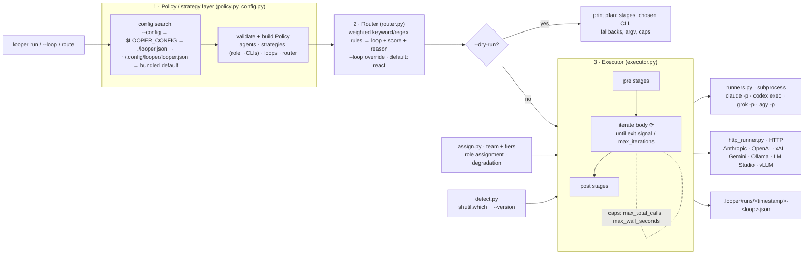

# looper

A standalone **multi-agent "forefront"**. A policy layer loads a playbook of agent loops from JSON, a router
picks the right loop for your task, and an executor runs that loop's stages on **your team** of 1–5 agents.
Team members can be:

- **coding-agent CLIs**: **Claude Code** (`claude`), **Codex** (`codex`), **Grok Build** (`grok`), **Antigravity** (`agy`). Each runs as a subprocess with no shell.
- **hosted API models**: Anthropic, OpenAI, xAI, Google Gemini, OpenRouter
- **local models**: Ollama, LM Studio, vLLM / llama.cpp, or any OpenAI-compatible server

Every model gets a **capability tier** (tiny → small → medium → large → xl → frontier), auto-detected from
its parameter count. The loops then **adapt to the team**: who plans, who codes, who judges, how much
context each model gets, and what to simplify when the team is small or weak.

```bash
looper setup                                   # pick models (1-5), then enter each API key
looper run "implement a rate limiter"          # route → explore_plan_code_commit → run
looper route "fix the bug in auth.py"          # explain the routing only
looper --loop tdd "add a test for the login flow"
looper models                                  # your team: tier, params, context, roles
looper agents                                  # every configured agent and whether it's ready
```

## Install

```bash
cd looper
python -m venv .venv && source .venv/bin/activate
pip install -e '.[dev]'
looper --version        # looper 0.5.1
pytest                  # all tests use fakes, so no real CLIs are needed
```

Python ≥ 3.10. Runtime deps: `typer`, `rich` (HTTP calls use the stdlib). Optional: `pip install -e '.[keyring]'`
to store API keys in the OS keyring. Build a wheel with `python -m build` or `pip wheel . -w dist --no-deps`.

## Frontends (the-office and friends)

looper is the engine. A UI should call it — never re-implement model/CLI execution.

```bash
looper version --json          # {name, version, api_version: 1, capabilities}
looper doctor --json           # exit 1 if not usable; never prints key values
looper plan --json "task"      # route + stage plan (no execution)
looper run --json-events "…"   # NDJSON event stream on stdout for the UI to render
looper ask --json --agent X "prompt"   # one character turn through the assigned model
printf '%s' "$LONG" | looper ask --json --agent X --stdin   # long prompts (no argv limit)
looper ask --json --agent X --prompt-file ./persona.txt
looper serve --port 8765       # optional local HTTP API (localhost; optional bearer token)
```

Passthrough (opaque to looper): `--role-labels-json '{"planner":"Michael"}'`, `--meta key=value`,
`--assign-json '{"planner":"codex"}'`, `--team-json` / `--team-file`. Full contract:
[`docs/FRONTEND_API.md`](docs/FRONTEND_API.md) and [`docs/events.schema.json`](docs/events.schema.json).


## Setup: choose your models, then your keys

```bash
looper setup
```

1. **Pick models.** The wizard shows a numbered menu with the agent CLIs it detected, hosted models from
   each provider, and local models it found on Ollama (`:11434`) and LM Studio (`:1234`), each with its
   size and tier. Choose how many agents you want (1–5, default 3), then pick each one by number or type
   any `provider:model`.
2. **Enter API keys.** This only happens *after* you've picked models, and only for the providers you chose.
   You get one hidden prompt per provider; leave it blank to skip. If the key is already in your environment,
   you're asked whether to keep it. Keys go to `~/.config/looper/credentials.env` (`$LOOPER_HOME` overrides;
   file mode `0600`, directory `0700`) or the OS keyring with `--keyring`. They **never** go in `looper.json`
   and are never printed (`••••abcd`).
3. The team is written to `~/.config/looper/looper.json` (or `--path ./looper.json`) as `agents` + `team`.

Non-interactive form:

```bash
looper setup --agent anthropic:claude-opus-5-5 --agent cli:codex --agent ollama:qwen3.5:9b
looper setup -a ollama:qwen3.5:4b --path ./looper.json              # one local model
looper setup -a openai_compatible:Qwen/Qwen3.6-27B@http://gpu-box:8000/v1#large   # vLLM + manual tier
looper setup -a xai:grok-4.7 --prompt-keys                          # also prompt (hidden) for missing keys

looper keys set anthropic          # hidden prompt; or: printf %s "$KEY" | looper keys set anthropic --stdin
looper keys list                   # where each key lives (env / keyring / file), masked
looper keys remove xai
```

Key lookup order at run time: environment variable → OS keyring (if installed) → `credentials.env`.

| Provider | `provider:` | Key env var | API style | Preset models (checked 2026-11-05, editable) |
|---|---|---|---|---|
| Anthropic | `anthropic` | `ANTHROPIC_API_KEY` | native Messages | `claude-opus-5-5`, `claude-sonnet-5-5`, `claude-haiku-5-5`, `claude-fable-5-1` |
| OpenAI | `openai` | `OPENAI_API_KEY` | Responses | `gpt-6-astra`, `gpt-6.1-sol`, `gpt-6-luna` |
| xAI | `xai` | `XAI_API_KEY` | OpenAI chat | `grok-4.7`, `grok-build-0.1`, `grok-4.3` |
| Google | `google` | `GEMINI_API_KEY` | OpenAI-compat | `gemini-4-argon`, `gemini-3.8-flash`, `gemini-3.5-flash-lite` |
| OpenRouter | `openrouter` | `OPENROUTER_API_KEY` | OpenAI chat | any id, e.g. `openrouter:qwen/qwen3.6-27b` |
| Ollama | `ollama` | none | native `/api/chat` (sets `num_ctx`, `num_predict`, `think`) | discovered |
| LM Studio | `lmstudio` | `LM_API_TOKEN` (optional) | OpenAI chat | discovered |
| vLLM / llama.cpp / other | `openai_compatible` | `LOOPER_COMPAT_API_KEY` (optional) | OpenAI chat | `model@base_url` |
| Agent CLIs | `cli` | the CLI's own login | subprocess | `claude`, `codex`, `grok`, `agy` |

**Important:** API and local agents are *text-only*. They can't read your repo or run commands. looper puts
tool stages (explore, code, run tests, commit) on a CLI agent when your team has one. Otherwise the plan
says those stages will return diffs and commands for you to apply.

## Teams of 1–5 agents

**Sweet spot 3, hard cap 5** (`defaults.recommended_agents` / `defaults.max_agents`). More copies of the same
model level off quickly. *Different* models add the most, so 3 well-chosen agents beat 5 similar ones.
See [docs/MODEL_TIERS.md](docs/MODEL_TIERS.md) for the research.

Each stage role (`coder`, `grader`, …) maps to an abstract role: planner, researcher, coder, tester,
reviewer, judge, editor, orchestrator, worker, generalist. looper then fits every loop to your team:

| Rule | Behaviour |
|---|---|
| Lead roles (planner, judge, reviewer, orchestrator) | strongest tier first, then the strategy preference |
| Other roles | strategy preference first, then strongest tier. API models inherit their vendor CLI's place (xAI ≈ `grok`, Anthropic ≈ `claude`, …) |
| Tool roles (explore, code, test, commit) | agents that can run tools (CLIs) first |
| Diversity (N ≥ 2) | the reviewer/judge isn't the agent (or vendor) that wrote the code; Best-of-N candidates come from different vendors first |
| Best-of-N | n = min(configured, capable agents, cap). With 1 agent: a medium+ API/local model samples 2× at temperature 0.2/0.9; a CLI or small model collapses to 1 candidate + self-critique |
| Orchestrator → workers | subtasks capped by tier (`max_map_items`); sequential with 1 agent; local models 1 at a time per server |
| Nobody capable of a stage | optional stage → skipped; mergeable stage → folded into the previous one; else runs on the strongest agent, flagged *under-tier* |
| Lite mode (best agent tiny/small) | optional stages skipped, fewer iterations, short "do one thing" prompts |

Everything that changed is listed under **"adapted to this team"** in `--dry-run` (and in `--json` /
transcripts as `degradations`).

## Capability tiers and local models

| Tier | Effective size* | Examples | Roles | Context sent (local) | Max output |
|---|---|---|---|---|---|
| tiny | < 1.5B | Qwen3.5‑0.8B, Gemma 3 270M | summarize / classify / format | 4k | 1k |
| small | 1.5–5B | Qwen3.5‑4B, Gemma 4 E4B, Phi‑4‑mini | + coder, tester, editor, worker, researcher | 8k | 4k |
| medium | 5–15B | Qwen3.5‑9B, gpt‑oss‑20b, Qwen3.6‑35B‑A3B | + planner, reviewer, judge (with care) | 16k | 4k |
| large | 15–40B | Qwen3.6‑27B, gpt‑oss‑120b, Qwen3.5‑122B‑A10B | all, incl. orchestrator | 32k | 8k |
| xl | 40B+ | Llama 3.3 70B, Qwen3.5‑397B‑A17B | all | 64k | 8k |
| frontier | hosted / CLIs | Claude, GPT‑6, Grok 4.7, Gemini 4 | all | model window | 16k |

\* dense: total params; MoE: `sqrt(total × active)`. Every limit is in the config's `tiers` section.

How a local model's tier is found: a manual `tier` wins. Otherwise looper uses metadata saved at setup from
Ollama `/api/show` (`general.parameter_count`, `<arch>.context_length`), LM Studio `/api/v1/models`
(`params_string`, `max_context_length`), or vLLM/llama.cpp `/v1/models` (`max_model_len`, `meta.n_params`).
Failing that, it parses the model name (`qwen3:8b`, `0.6B`, `270m`, `30b-a3b`, `8x7b`, `e4b`). Unknown sizes
default to `medium`. Override a tier with `--agent ollama:my-model#large` or `"tier": "large"`.

What works best locally: **run sequentially** (`defaults.max_parallel_local: 1`, the default; Ollama itself
serves one request per model by default). Prefer **one large model** (27B dense or 35B‑A3B MoE on 24–32 GB)
over several small ones. If you can, **pair it with one hosted model** for planning and judging. looper
sends an explicit `num_ctx`, because Ollama's own default can be as small as 4k on cards under 24 GB.

`looper models --discover` lists what your local servers have, with ready-to-paste `--agent` specs.

## Portable team spec (for other apps)

[`docs/team_spec.json`](docs/team_spec.json) is a language-neutral description of the tiers, role taxonomy,
size-parsing regexes, detection endpoints, credential rules and the step-by-step assignment/degradation
algorithm. A JS app (e.g. the-office) can mirror looper's behaviour from it. Regenerate it with
`looper spec --write docs/team_spec.json` after changing tiers or roles.

## Architecture



| Module | Role |
|---|---|
| `config.py` | Config discovery, JSON loading, merging over the bundled default (`looper/data/default_config.json`, loaded with `importlib.resources`) |
| `policy.py` | Validates config into typed `Policy` / `LoopSpec` / `StageSpec` / `RouteRule`; exit-signal matching |
| `router.py` | Scores every loop's rules against the prompt and returns `RouteDecision(loop, score, method, reason, ranking)` |
| `detect.py` | `shutil.which` + optional `--version` probe (short timeout, run in parallel); `$LOOPER_<NAME>_BIN` overrides |
| `executor.py` | Stage sequencing, iteration, exit signals, caps, agent fallback, Best-of-N / map fan-out, dry-run plan, transcripts |
| `runners.py` | `SubprocessRunner` (stdin closed, timeout, captured output); `DispatchRunner` routes cli → subprocess, api/local → HTTP. Tests inject a fake runner. |
| `http_runner.py` | Stdlib HTTP client for OpenAI chat, OpenAI Responses, Anthropic Messages, Ollama `/api/chat`; injectable transport; keys scrubbed from errors |
| `tiers.py` | Size parsing (names, MoE), tier resolution, usable context |
| `assign.py` | Team building, role assignment, diversity, graceful degradation (`adapt`) |
| `local.py` | Ollama / LM Studio / OpenAI-compatible model discovery and metadata |
| `credentials.py` | Key storage (env → keyring → `credentials.env` 0600), masking |
| `setup.py` | Agent spec parsing, local probing, writing the team into looper.json |
| `spec.py` | Builds `docs/team_spec.json` |
| `cli.py` | Typer app. `LooperGroup` makes `looper [opts] "task"` an alias for `looper run [opts] "task"` |

## Commands

| Command | What it does |
|---|---|
| `looper run "task"` | Route, then execute. Reads stdin if omitted; also `--stdin` / `-` / `--prompt-file`. |
| `looper ask --agent NAME "prompt"` | One prompt → one agent. `--stdin` / `-` / `--prompt-file` for long prompts. |
| `looper plan "task"` | Route + adapt; print stage plan (no execution). Same long-prompt flags as `run`. |
| `looper "task"` / `looper --loop tdd "task"` | Shorthand for `run` (the first non-option token isn't a subcommand) |
| `looper route "task"` | Show the chosen loop, score, matched rules and ranking. Runs nothing. |
| `looper setup` | Wizard: pick 1–5 models, then enter each provider's key (hidden). `--agent provider:model …` for scripts |
| `looper keys set/list/remove` | Manage API keys (masked; never in looper.json) |
| `looper models [--discover]` | Team with tier, size, usable context, allowed roles, readiness; `--discover` lists local models |
| `looper agents` | Every configured agent: kind, installed/ready, tier, size, version/model, path/endpoint (★ = in team) |
| `looper spec [--write PATH]` | Export the language-neutral team/tier spec |
| `looper loops` | List all loops |
| `looper show <loop>` | Stages, agent preferences, exit conditions, caps, route rules |
| `looper init [--path p] [--force]` | Write the full sample config to `./looper.json` |
| `looper validate` | Validate the effective config |

Flags for `run` (and the root shorthand):

| Flag | |
|---|---|
| `--loop/-l NAME` | Skip routing and force a loop |
| `--config/-c PATH` | Config file |
| `--dry-run` | Print the plan (team, stage → agent + tier, fallbacks, notes, commands, iteration, caps, worst-case calls, **what was adapted to the team**) and execute nothing |
| `--json` | JSON output (plan, run result, route, agents) |
| `--max-iterations/-n N` | Override the loop's `iterate.max_iterations` |
| `--agent/-a NAME` | Force every stage onto one agent (CLI or team member) |
| `--cwd DIR` | Working directory for the CLIs (transcripts are written under it) |
| `--no-transcript`, `--quiet/-q` | |
| `--stdin` | Read the task/prompt from stdin (avoids OS argv length limits) |
| `--prompt-file PATH` | Read the task/prompt from a file |
| `-` (as the task/prompt) | Same as `--stdin` |

Examples:

```bash
looper route "production is down 500 errors"           # → incident_response
looper route --json "research the best vector DB"      # → deep_research
looper run "implement a rate limiter" --dry-run
looper --loop best_of_n "name this CLI tool" --json
looper run "fix the flaky test in test_auth.py" -a claude -n 2
git diff | looper --loop editor_slop_grader            # task from stdin
looper show tdd
```

When stdout is captured, run progress goes to stderr and the final output goes to stdout. Each real run writes
`.looper/runs/<YYYYMMDD-HHMMSS-ffffff>-<loop>.json` with the route decision, every stage's rendered prompt,
every call (agent, argv with long prompts elided, return code, timing, output), iterations, exit signal and status
(`ok` | `capped` | `failed`).

## Loop catalog (bundled playbook)

| Loop | Stages | Iteration / exit | Caps (calls / wall) |
|---|---|---|---|
| `react` (default) | step | `step` ≤6× until `FINAL ANSWER:` | 8 / 1800s |
| `explore_plan_code_commit` | explore → plan → code → verify → commit | `code+verify` ≤3× until `LGTM` | 12 / 3600s |
| `research_plan_implement` | research → plan → implement → review | `implement+review` ≤3× until `LGTM` | 10 / 3600s |
| `spec_driven` | spec → spec_review → implement → conformance | `implement+conformance` ≤3× until `SPEC SATISFIED` | 10 / 3600s |
| `evaluator_optimizer` | generate → evaluate → optimize | `evaluate+optimize` ≤4× until `LGTM` | 10 / 2700s |
| `best_of_n` | candidates[parallel ×3] → judge | single pass | 6 / 1800s |
| `orchestrator_workers` | orchestrate → workers[map] → synthesize | single pass | 10 / 3600s |
| `pdca` | plan → do → check → act | all four ≤3× until `TARGET MET` | 12 / 3600s |
| `tdd` | write_test → implement → run_tests → refactor | `implement+run_tests` ≤5× until `ALL TESTS PASS` | 14 / 3600s |
| `incident_response` | triage → diagnose → mitigate → verify → postmortem | `mitigate+verify` ≤3× until `MITIGATED` / `RESOLVED` | 10 / 1800s |
| `musk_algorithm` | question_requirements → delete → simplify → accelerate → automate | single pass | 7 / 3600s |
| `deep_research` | scope → gather → gap_check → report | `gather+gap_check` ≤3× until `SUFFICIENT` | 9 / 3600s |
| `hypothesis_tool_scout` | hypothesize → scout[map] → decide → apply → verify | `apply+verify` ≤3× until `VERIFIED` | 14 / 3600s |
| `editor_slop_grader` | grade → edit → regrade | `edit+regrade` ≤3× until `re:SLOP SCORE:\s*[0-2]\b` | 8 / 1800s |

Sample routes: "implement a rate limiter" → `explore_plan_code_commit`; "fix the bug in auth.py" →
`hypothesis_tool_scout`; "add a test for the login flow" → `tdd`; "production is down 500 errors" →
`incident_response`; "research the best vector DB" → `deep_research`; anything that scores below
`router.min_score` → `react`.

Default role strategies: **claude** for planning, coding and judging; **codex** for tests and
implementation-heavy stages; **grok** for research, scouting and requirement-skepticism; **agy** for review,
grading and alternate candidates. Every stage then falls back through `defaults.fallback_agents`.

## Configuration

`looper init` writes the full bundled config (from `src/looper/data/default_config.json`).
A user config is **merged over the bundled default**, so a small file is enough:

```json
{
  "agents": { "grok": { "binary": "/opt/grok/bin/grok" } },
  "strategies": { "coder": ["codex", "claude"] },
  "router": { "default_loop": "tdd" },
  "loops": { "musk_algorithm": null }
}
```

Merge rules: `defaults`/`router` deep-merge; `agents`, `tiers`, `roles`, `providers` merge per entry;
`strategies` replace per role; `loops` replace per loop (`null` removes one); `team` replaces.
Set `"inherit_defaults": false` to use your file alone.

A team config written by `looper setup` looks like this:

```json
{
  "agents": {
    "claude-opus-5-5": { "kind": "api", "provider": "anthropic", "model": "claude-opus-5-5" },
    "qwen3.6-27b": { "kind": "local", "provider": "ollama", "model": "qwen3.6:27b",
                     "params_b": 27.8, "context_window": 262144 }
  },
  "team": ["claude-opus-5-5", "codex", "qwen3.6-27b"]
}
```

Agent fields (api/local): `kind`, `provider`, `model`, `base_url`, `api_key_env`, `api_style`
(`openai` | `openai_responses` | `anthropic` | `ollama`), `tier`, `params_b`, `active_params_b`,
`context_window`, `num_ctx`, `max_output_tokens`, `roles` (restrict to these abstract roles), `tools`.
Stage fields added in v0.3: `optional`, `mergeable`. New defaults: `max_agents` (5), `recommended_agents` (3),
`max_parallel_local` (1), `max_best_of_n` (5), `single_agent_samples` (2), `chars_per_token` (3.5),
`context_fill` (0.5), `unknown_local_tier` ("medium"). Without a `team`, every configured agent that is
ready may be used (the v0.2 behaviour).

### Schema

```jsonc
{
  "defaults": {
    "timeout_seconds": 900,          // per call (stage.timeout_seconds > agent.timeout_seconds > this)
    "max_iterations": 3,             // used when a loop's iterate omits it
    "caps": { "max_total_calls": 20, "max_wall_seconds": 3600 },   // per-loop caps fall back to these
    "fallback_agents": ["claude", "codex", "grok", "agy"],          // appended to every stage's preference
    "fallback_on_error": true,       // a failed/timed-out call retries on the next installed CLI
    "max_context_chars": 20000,      // each {{var}} is clipped (head+tail) to this size
    "runs_dir": ".looper/runs",
    "version_probe_timeout": 3
  },
  "agents": {
    "claude": {
      "binary": "claude",                       // name on PATH or absolute path ($LOOPER_CLAUDE_BIN overrides)
      "command": ["{binary}", "-p", "{prompt}"],// argv template, no shell
      "prompt_via": "arg",                      // "arg" | "stdin" | "auto" (auto switches to stdin above ~100KB)
      "version_args": ["--version"],
      "env": {}, "timeout_seconds": null, "description": "..."
    }
  },
  "strategies": { "planner": ["claude", "agy", "codex"], "...": [] },   // role → agent preference
  "router": { "default_loop": "react", "min_score": 2 },
  "loops": {
    "tdd": {
      "description": "...",
      "priority": 7,                                  // tie-breaker in routing
      "route": [ { "keyword": "test", "weight": 4 },  // word-boundary, case-insensitive
                 { "regex": "\\bred[ -/]green\\b", "weight": 5 } ],
      "stages": [
        { "name": "write_test", "role": "tester", "prompt": "TASK:\n{{task}} ..." },
        { "name": "implement", "role": "coder", "agents": ["claude", "codex"],   // optional override
          "artifact": true, "timeout_seconds": 1200,
          "prompt": "... {{outputs.write_test}} ... {{outputs.run_tests}}" },
        { "name": "run_tests", "role": "tester", "prompt": "... print 'ALL TESTS PASS' ..." },
        { "name": "refactor", "role": "reviewer", "prompt": "..." }
      ],
      "iterate": { "body": ["implement", "run_tests"],   // contiguous; stages before = pre, after = post
                   "max_iterations": 5,
                   "exit_signals": ["ALL TESTS PASS"],   // substring (case-insensitive) or "re:<regex>"
                   "check_stages": ["run_tests"] },      // which body stages are scanned (default: all)
      "caps": { "max_total_calls": 14, "max_wall_seconds": 3600 }
    }
  }
}
```

Stage `type`:

* `single` (default): one call, with fallback to the next installed CLI.
* `parallel` + `n`: Best-of-N. Runs `n` candidates concurrently in a `ThreadPoolExecutor`, rotating the start of the
  preference list so the candidates spread across CLIs. The joined output (`### Candidate i (agent)`) feeds the next
  (judge) stage.
* `map` + `source` (+ `max_items`, `max_workers`): Orchestrator→Workers. Splits the `source` stage's output into items
  (a JSON array, else bullet or numbered lines) and runs one concurrent call per item with `{{item}}`.

Prompt variables: `{{task}}`, `{{iteration}}`, `{{previous}}` (last stage output), `{{previous_artifact}}`
(latest output of an `artifact: true` stage), `{{outputs.<stage>}}` (latest output of that stage, or `(none yet)`),
`{{item}}` (map), `{{candidate}}` (parallel).

The final output is the last stage's output. If the run ended on a non-artifact check stage inside the loop
(for example an evaluator's `LGTM`), it is the latest artifact instead.

### Adding a loop

1. `looper init` (or edit `~/.config/looper/looper.json`) and add under `"loops"`:

```json
"security_review": {
  "description": "Threat-model, audit, fix until clean.",
  "priority": 6,
  "route": [{ "keyword": "security", "weight": 4 }, { "regex": "\\b(cve|xss|sqli|owasp)\\b", "weight": 4 }],
  "stages": [
    { "name": "threat_model", "role": "planner", "prompt": "TASK:\n{{task}}\n\nWrite a threat model." },
    { "name": "fix", "role": "coder", "artifact": true,
      "prompt": "TASK:\n{{task}}\n\nThreats:\n{{outputs.threat_model}}\nAudit findings:\n{{outputs.audit}}\n\nFix them." },
    { "name": "audit", "role": "reviewer",
      "prompt": "TASK:\n{{task}}\n\nAudit the working tree. Reply 'NO FINDINGS' if clean." }
  ],
  "iterate": { "body": ["fix", "audit"], "max_iterations": 3, "exit_signals": ["NO FINDINGS"], "check_stages": ["audit"] },
  "caps": { "max_total_calls": 8, "max_wall_seconds": 1800 }
}
```

2. `looper validate`, `looper show security_review`, `looper route "audit for XSS"`, then `looper run ... --dry-run`.
3. To change the bundled playbook itself, edit `tools/gen_default_config.py` and run it. It regenerates
   `src/looper/data/default_config.json`. For a local editable copy, run `looper init`.

## Agent CLI notes

| CLI | Default template | Notes |
|---|---|---|
| claude | `claude -p <prompt>` | Claude Code print mode. Add `--permission-mode acceptEdits` or `--dangerously-skip-permissions` to `command` for unattended edits. |
| codex | `codex exec --skip-git-repo-check <prompt>` | Add `--full-auto` (or a sandbox flag) for unattended writes. |
| grok | `grok -p <prompt> --no-auto-update` | Grok Build headless mode. Add `--always-approve`/`--yolo` or `--permission-mode` for unattended tool use. |
| agy | `agy -p <prompt>` | Antigravity print mode. Add `--dangerously-skip-permissions` (and `--sandbox`) for unattended tool use. Otherwise a tool-using prompt can block until the timeout. |

By default looper doesn't auto-approve tool use for any CLI, so you opt into that per agent in config. Prompts are
passed as a single argv element by default (`prompt_via: "arg"`), with the child stdin closed so nothing hangs on
interactive input. Linux caps one argument at about 128 KB, which is why `max_context_chars` clips injected outputs
and why frontends should call `looper ask --stdin` / `--prompt-file` for long persona prompts.

For the child CLI itself, set `"prompt_via": "stdin"` (always pipe) or `"prompt_via": "auto"` (argv for short
prompts, stdin above ~100 KB). With `"arg"` (default), a prompt longer than 100 KB raises a clear error instead of
silently truncating against `ARG_MAX`.

## Tool calls (caller-owned)

`looper ask` can return structured `tool_calls` when you offer tools. **looper
never runs them** — your app (e.g. the-office desk) does. See
[`docs/FRONTEND_API.md`](docs/FRONTEND_API.md) for the request/response shape,
protocol table, and multi-step loop. Capabilities: `tool_calls`, `tool_results`.

```bash
looper ask --json --agent sonnet --request-json - <<'EOF'
{
  "prompt": "write src/hi.js that logs hello",
  "tools": [
    {"name": "write_file", "description": "Write a file",
     "parameters": {"type": "object",
       "properties": {"path": {"type": "string"}, "content": {"type": "string"}},
       "required": ["path", "content"]}}
  ]
}
EOF
```

